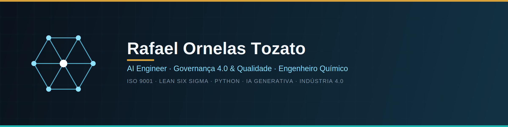

  
  
  
  
  
  

  

# Rafael Ornelas Tozato
### Especialista em Garantia da Qualidade & Governança Industrial | Desenvolvedor Full-Stack & Data Analytics (IA Aplicada)

Minha trajetória profissional de mais de 20 anos é fundamentada no rigor da Gestão da Qualidade, com sólida experiência na otimização de processos produtivos, redução de desperdícios e garantia da excelência operacional em ambientes industriais de alta complexidade. 

Acredito que a maturidade técnica, aliada à capacidade de análise crítica, é o que sustenta decisões de negócio sólidas.

Atualmente, dedico minha jornada à convergência entre a robustez dos processos industriais e a engenharia de software moderna. Utilizo inteligência artificial e ferramentas de ponta para transformar dados brutos em soluções digitais completas — desenvolvendo desde dashboards executivos de BI até aplicações web funcionais prontas para produção.

---

## 🛠️ Core Competencies & Tech Stack

* **Engenharia de Software & Web:** React, TypeScript, Tailwind CSS, shadcn/ui e Single Page Applications (SPA/PWA).
* **Desenvolvimento Agilizado & Cloud:** v0 (Vercel), Lovable, Deploy Contínuo (CI/CD) e arquiteturas otimizadas em nuvem.
* **Data Analytics & BI:** Inteligência Financeira, Modelagem de KPIs, Dashboards Interativos e Análise de Dados Corporativos.
* **Gestão Industrial & Qualidade:** Governança de Processos, Garantia da Qualidade, Melhoria Contínua e Indústria 4.0.
  
---

### 💻 Projetos e Portfólios
* **Dev Hub:** [tozato-dev-hub.vercel.app](https://tozato-dev-hub.vercel.app)
* **H-Folio:** [h-folio-l0-vercel.app](https://h-folio-l0.vercel.app/)

---
### 🐙 Código e Repositórios
* **GitHub:** [github.com/Rafael-TOZATO](https://github.com/Rafael-TOZATO)
---
### 📝 Artigos e Publicações
* **Medium:** [medium.com/@ornelas.tozato](https://medium.com/@ornelas.tozato)
---
### 🎓 Certificações e Educação
* **Microsoft Learn:** [Transcrito Oficial](https://learn.microsoft.com/pt-br/users/rafaelornelastozato-2209/transcript/dzo2wizrkx2853)

---

## 📬 Contatos

- 💼 **LinkedIn:** [rafaeltozato81](https://www.linkedin.com/in/rafaeltozato81)
- 🐙 **GitHub:** [Rafael-TOZATO](https://github.com/Rafael-TOZATO)
- ✍️ **Medium:** [@ornelas.tozato](https://medium.com/@ornelas.tozato)
- 🌐 **Portfólio PWA (Dev Hub):** [tozato-dev-hub.vercel.app](https://tozato-dev-hub.vercel.app)
- 🌐 **H-Folio:** [h-folio-l0-vercel.app](https://h-folio-l0.vercel.app/)
- 📜 **Microsoft Learn:** [Transcript](https://learn.microsoft.com/pt-br/users/rafaelornelastozato-2209/transcript/dzo2wizrzkx2853)

---

> *"Transforme ideias em impacto através da convergência entre rigor industrial e engenharia de software."*
